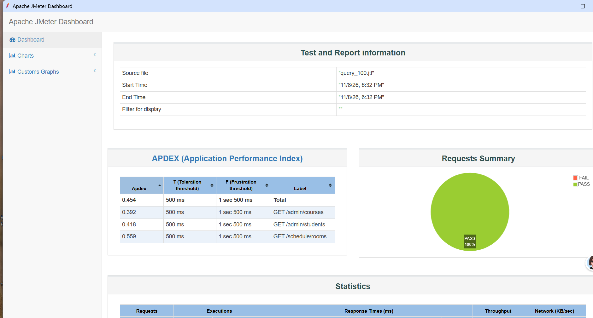

# 教务管理系统接口性能测试（JMeter）

基于 **Apache JMeter 5.6.3** 对 Spring Boot 教务管理系统做的负载测试工程：两个核心场景、三级并发梯度，产出可复现的脚本、HTML 报告与一份带根因定位的性能分析报告。

> **一句话结论**：同一环境下登录接口 7.4 TPS、查询接口 164 TPS，相差 22 倍——瓶颈不在数据库，而在 **BCrypt 密码校验的 CPU 开销** 与 **MyBatis 同步控制台日志 I/O**。100 并发是当前配置下登录接口的不可用边界（13.54% 超时）。

## 报告截图



> 查询场景 100 并发：2233 个请求、**0 失败**、吞吐 73.8 TPS、平均 1249 ms。零错误但延迟比 10 并发劣化 22 倍——这是"资源排队"而不是"接口报错"的典型形态，也是判断该扩资源还是该改代码的分界线。

## 关键数据

**场景一：登录 `POST /api/auth/login`**

| 并发 | TPS | 平均 (ms) | P95 (ms) | 错误率 |
| --- | --- | --- | --- | --- |
| 10 | 7.38 | 1245 | 4018 | 0% |
| 50 | 6.92 | 6546 | 11569 | 0% |
| 100 | 12.01 | 7600 | 15010 | **13.54%** |

**场景二：核心查询（学生列表 / 课程列表 / 教室字典）**

| 并发 | TPS | 平均 (ms) | P95 (ms) | 错误率 |
| --- | --- | --- | --- | --- |
| 10 | 164.49 | 56 | 125 | 0% |
| 50 | 86.36 | 534 | 1618 | 0% |
| 100 | 73.80 | 1249 | 3086 | 0% |

典型拐点特征：**并发翻倍、吞吐腰斩、延迟放大 10 倍，但零错误** —— 说明是资源排队，不是接口出错。

## 目录结构

```
教务系统性能测试/
├── jmx/
│   ├── login_stress.jmx          # 登录接口压测（含业务码断言、token 提取）
│   └── query_stress.jmx          # 核心查询压测（携带 Bearer token）
├── scripts/
│   └── run_all.ps1               # 一键跑 10/50/100 三级梯度并汇总指标
├── docs/
│   ├── 性能测试报告.md            # 完整报告：环境、模型、数据、瓶颈定位、优化建议
│   └── images/                   # README 展示用截图（JMeter Dashboard）
├── results/
│   ├── summary.csv               # 各轮 TPS / 分位 / 错误率汇总（随仓库提交）
│   └── html/                     # JMeter 官方 HTML 报告（gitignore，本地生成）
└── README.md
```

## 快速开始

```powershell
# 1. 确认被测后端在跑：POST http://localhost:8082/api/auth/login 应返回 code 200 + token

# 2. 一键执行全部梯度（默认 10/50/100 并发、30 秒、爬坡 5 秒）
powershell -NoProfile -ExecutionPolicy Bypass -File scripts\run_all.ps1

# 3. 自定义梯度与时长
powershell -File scripts\run_all.ps1 -Threads "20,60,120" -Duration 60 -Ramp 10

# 4. JMeter 不在默认路径时
powershell -File scripts\run_all.ps1 -JmeterHome "F:\apache-jmeter-5.6.3"
```

执行完成后：

- `results\summary.csv` —— 各轮指标汇总，可直接对比优化前后；
- `results\html\<场景>_<并发>\index.html` —— JMeter 官方 Dashboard 报告，含 TPS 曲线、响应时间分布、百分位表。

手动单轮执行：

```powershell
jmeter -n -t jmx\login_stress.jmx -Jthreads=50 -Jramp=5 -Jduration=30 `
       -l results\login_50.jtl -e -o results\html\login_50
```

## 场景脚本说明

| 脚本 | 场景 | 关键设计 |
| --- | --- | --- |
| `login_stress.jmx` | `POST /auth/login` | `postBodyRaw` 传 JSON；响应断言匹配 `"code":200`（不只看 HTTP 200）；`JSONPostProcessor` 提取 `$.data.token` |
| `query_stress.jmx` | 学生分页 / 课程分页 / 教室字典 | token 由外部独立登录取得后经 `-Jtoken` 注入，**保证查询耗时不含登录成本**；统一 `Authorization: Bearer` 头 |

两个脚本均参数化：`-Jthreads`、`-Jramp`、`-Jduration`、`-Jhost`、`-Jport`，无需改动 jmx 即可调梯度。

## 测试方法上的几个取舍

1. **非 GUI 执行**（`-n`）：排除 JMeter 界面自身的 CPU 与内存开销对被测结果的污染。
2. **断言放在业务码上**：后端拦截类场景 HTTP 仍是 200、业务码才是真结果，只断言 HTTP 状态会把失败当成功统计。
3. **查询场景不混入登录**：token 预先取得再注入，否则登录的 BCrypt 开销会伪装成查询耗时。
4. **15 秒响应超时即记失败**：把"用户已经放弃等待"作为失败阈值，比"连接不通才算失败"更贴近真实体验。
5. **分位而非平均值**：平均值会被少数快请求拉低，P95/P99 才能暴露长尾。10 并发时平均 1.2 s 但 P99 已达 10.7 s。

## 已知局限

- **单机压测**：JMeter 与被测后端同机，共享 4 核 CPU，绝对 TPS 低于独立压测机结果。数据用于同环境横向对比与瓶颈定位，不代表生产容量。
- 测试环境为本地开发配置（DEBUG 日志、Druid `max-active: 20`、Jedis 池 8），与生产配置有差异，优化前后对比须在同一基线进行。
- 压测期间 `admin` 账号 token 被反复覆盖（后端单端在线策略），其他会话可能被顶下线。

## 相关文档

- 完整分析：`docs/性能测试报告.md`（含瓶颈证据链、四条优化建议与预期收益）
